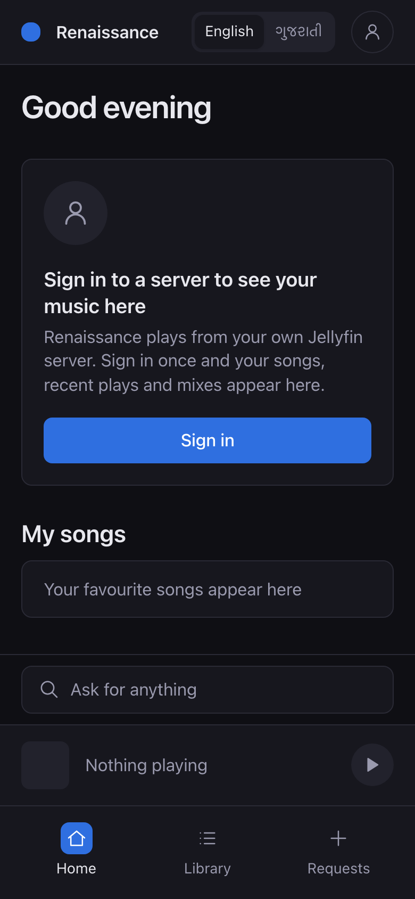
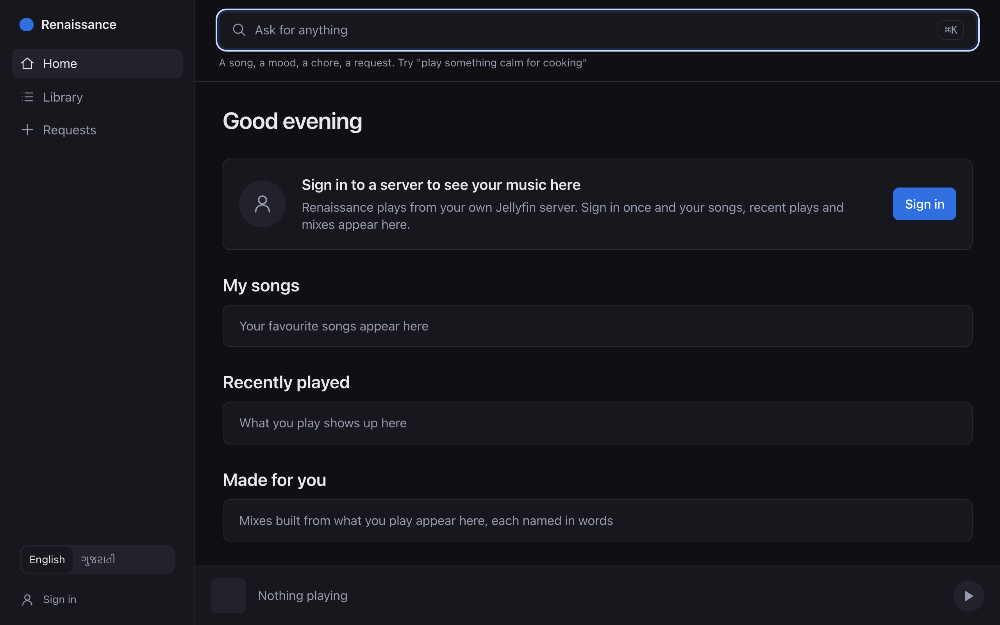

# Renaissance

**An AI-first, self-hosted music app for Jellyfin libraries.** One box, any words, any language; your own
library, any song fetched. Web app for desktops and browsers, native app for iPhone, iPad and Android, one
shared TypeScript core. GPL-3.0.

> **Status: pre-alpha, phase 0 (scaffold).** Nothing plays yet. The repo, tooling, CI, design tokens and
> the hub's API shape exist; features land phase by phase (see the [roadmap](docs/ROADMAP.md)).

## The idea

Spotify's strength is a taste graph built from a billion listeners. Ours is that we own the library, can
fetch anything, and have a model that understands plain language and your own history. So Renaissance is
built around one box that takes anything: a song name, a half-remembered lyric, a mood, a chore, a request,
a playlist to build, in English or Gujarati, typed or spoken. The model is the hands behind the box, never a
chat screen: it turns words into intent and acts only through a fixed set of tools on real data (your
library, a music catalogue, the queue, playlists, requests). It cannot name a song the catalogue or your
library did not return. Every action shows what it did and has an undo. Simple commands and exact matches
never touch the model at all. The model runs on a small server-side hub next to your Jellyfin, so keys and
history never leave your house and one hub serves every phone and browser in it.

## Screenshots

Phase 0, signed out, simple mode, dark. Every width, language and theme is in
[`docs/screens/phase-0/`](docs/screens/phase-0/); the rules are in
[`packages/design/DESIGN.md`](packages/design/DESIGN.md) and the mockup in
[`docs/design/mockup-2026-11-17.html`](docs/design/mockup-2026-11-17.html).

<p>
  
  
</p>

## What you need on the server

| Piece                                                                    | Needed for                                                   | Version            |
| ------------------------------------------------------------------------ | ------------------------------------------------------------ | ------------------ |
| [Jellyfin](https://jellyfin.org) with a Music library                    | everything                                                   | 10.10 or later     |
| Renaissance Hub (this repo, `apps/hub`)                                  | the Ask bar, requests, enrichment, mixes                     | ships with the app |
| [Lidarr](https://lidarr.audio) + [slskd](https://github.com/slskd/slskd) | optional: requesting music you do not have                   | current            |
| An Anthropic API key, set on the hub only                                | optional: the Ask bar's intent engine and library enrichment | n/a                |

Nothing else. No account with us, no telemetry.

## Run it (developers)

```sh
corepack enable            # or: npm i -g pnpm
pnpm install
pnpm dev                   # web on http://localhost:5173, hub on http://localhost:8787
pnpm --filter mobile start # Expo dev server (needs Xcode or Android Studio, or Expo Go)
```

Checks: `pnpm lint`, `pnpm typecheck`, `pnpm test`, `pnpm build`. A demo Jellyfin with Creative Commons
music for tests and for contributors without a library: `node docker/demo/start.mjs` (needs Docker;
it completes the Jellyfin wizard, creates the `demo` user and the music library, and prints the
password). The hub's routes and curl lines are in [docs/hub-api.md](docs/hub-api.md); its container
image is `apps/hub/Dockerfile`. Screenshots at phone, tablet and desktop widths are in
`docs/screens/`.

## Repository

```
apps/web        React 19, Vite, Tailwind 4, React Router, TanStack Query
apps/mobile     Expo (React Native), expo-router
apps/hub        Node, Fastify: intent engine, catalogue, fetch pipeline, enrichment; holds every key
packages/core   Everything that is not a screen: adapters, models, queue, playback policy, i18n
packages/design Design tokens and DESIGN.md
docs/           ROADMAP.md, hub-api.md, adr/, design/, screens/
docker/demo     Demo Jellyfin with Creative Commons tracks
```

## Contributing

Read [CONTRIBUTING.md](CONTRIBUTING.md). Issues labelled `good first issue` are a fine start. Design
rules live in `packages/design/DESIGN.md`; the hub's never-invent rule in `docs/adr/0007-ai-first-ask-bar-and-hub.md`.

## Licence

GPL-3.0-or-later. See [LICENSE](LICENSE) and [NOTICE](NOTICE).
